# Introducción

- Un supuesto fundamental del modelo de regresión lineal clásico es la homocedasticidad: la varianza del término de error es constante. Sin embargo, en los datos financieros a menudo observamos una varianza que cambia en el tiempo (heterocedasticidad). Aquí entra en juego el modelo GARCH (Heterocedasticidad Condicional Autorregresiva Generalizada).

- En esta unidad se introduce el modelo **GARCH**, utilizado para modelar la volatilidad de series temporales, especialmente en el análisis de datos financieros.

## ¿Qué es la volatilidad?

- Describe la **dispersión de los retornos** de un activo financiero a lo largo del tiempo.
- Se calcula usualmente como la desviación estándar (o la varianza) de los retornos.
- A mayor volatilidad, **mayor riesgo** del activo.
- **Heterocedasticidad**, del griego *hetero* ("diferente") + *skedasis* ("dispersión"): la serie muestra una volatilidad que varía de forma sistemática en el tiempo.

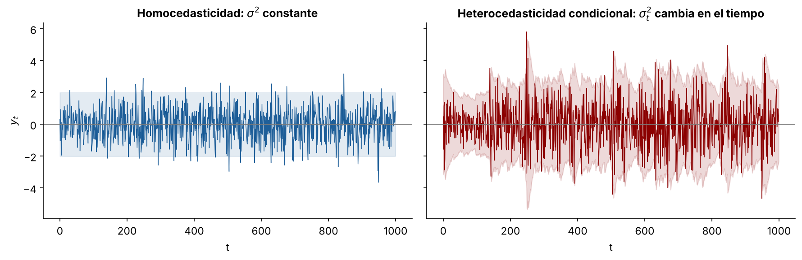{fig-align="center" width="100%"}

## Características de las series financieras

McNeil et al. (2005) enumeran hechos estilizados sobre las series temporales financieras:

1.  Las series de rendimientos financieros no son independientes ni idénticamente distribuidas, aunque muestran **poca autocorrelación**.
2.  Las series de rendimientos absolutos o al cuadrado muestran una autocorrelación significativa.
3.  Los rendimientos esperados condicionales son cercanos a cero.
4.  **La volatilidad parece variar con el tiempo.**
5.  Las series de rendimientos presentan leptocurtosis o colas pesadas.
6.  Los rendimientos extremos aparecen agrupados.

::: {.callout-note}
- La fórmula para calcular los retornos diarios de una acción es: $r_t = \dfrac{p_t - p_{t-1}}{p_{t-1}} \times 100$
- Es la diferencia entre el precio actual y el precio anterior, dividida por el precio anterior y multiplicada por 100 para expresarla como cambio porcentual.
:::

```{python}
import numpy as np
import pandas as pd
import matplotlib.pyplot as plt
import yfinance as yf

# Alphabet (GOOGL), 2010-2024: precios ajustados por splits y dividendos
googl = yf.download(
    "GOOGL", start="2010-01-01", end="2025-01-01", auto_adjust=True, progress=False
)
precios = googl["Close"].squeeze()  # Series (yfinance devuelve columnas MultiIndex)

retornos = 100 * precios.pct_change().dropna()  # retornos simples en %
log_retornos = 100 * np.log(precios).diff().dropna()  # log-retornos en %

# Serie y retornos
fig, axes = plt.subplots(2, 1, figsize=(15, 8), sharex=True)

axes[0].plot(precios.index, precios, color="black")
axes[0].set_title("Precio de cierre Alphabet (GOOGL)")
axes[0].set_ylabel("USD")

axes[1].plot(retornos.index, retornos, color="steelblue")
axes[1].axhline(0, color="grey", linewidth=0.8)
axes[1].set_title("Retornos diarios Alphabet (GOOGL)")
axes[1].set_ylabel("%")

plt.tight_layout()
plt.show()
```

## Análisis de los retornos

```{python}
from statsmodels.graphics.tsaplots import plot_acf
from scipy import stats

# Gráficos de diagnóstico (usa `retornos` de GOOGL definido antes)
fig, axes = plt.subplots(2, 2, figsize=(15, 8))
axes[0, 0].plot(retornos.index, retornos, label="Retornos GOOGL", color="steelblue")
axes[0, 0].set_title("Retornos diarios Alphabet (GOOGL)")
axes[0, 0].set_ylabel("%")
axes[0, 0].legend()

plot_acf(retornos, lags=36, ax=axes[0, 1], title="ACF de los retornos")
plot_acf(retornos**2, lags=36, ax=axes[1, 0], title="ACF de los retornos al cuadrado")

stats.probplot(retornos.values, dist="norm", plot=axes[1, 1])
axes[1, 1].set_title("Q-Q plot de los retornos")
plt.tight_layout()
plt.show()

# Estadísticas descriptivas
promedio_diario = retornos.mean()
volatilidad_diaria = retornos.std()
skewness = retornos.skew()
kurtosis_exceso = retornos.kurtosis()
cv_retornos = volatilidad_diaria / promedio_diario

# Anualización (252 días hábiles)
promedio_anual = promedio_diario * 252
volatilidad_anual = volatilidad_diaria * np.sqrt(252)

print("=" * 40)
print("ESTADÍSTICAS DE RETORNOS (GOOGL)")
print("=" * 40)
print(f"Promedio aritmético diario : {promedio_diario:.4f}%")
print(f"Promedio anualizado        : {promedio_anual:.2f}%")
print(f"Volatilidad diaria (Std)   : {volatilidad_diaria:.4f}%")
print(f"Volatilidad anualizada     : {volatilidad_anual:.2f}%")
print(f"Coeficiente de variación   : {cv_retornos:.4f}")
print("-" * 40)
print(f"Asimetría (Skewness)       : {skewness:.4f}")
print(f"Curtosis en exceso         : {kurtosis_exceso:.4f}")
print("=" * 40)

# Verificación rápida de normalidad (Jarque-Bera)
jb_stat, jb_p_value = stats.jarque_bera(retornos)
print(f"Prueba Jarque-Bera p-valor : {jb_p_value:.6e}")
```

## Agrupamiento de volatilidad (*volatility clustering*)

- "Los cambios grandes tienden a ser seguidos por cambios grandes, de cualquier signo, y los cambios pequeños por cambios pequeños" (Mandelbrot, 1963).
- Ejemplo con los log-retornos diarios de **Alphabet (GOOGL), 2010–2024**:

```{python}
fig, axes = plt.subplots(1, 2, figsize=(15, 4))
plot_acf(
    log_retornos,
    lags=100,
    zero=False,
    auto_ylims=True,
    ax=axes[0],
    title="ACF de los log-retornos: casi nula",
)
plot_acf(
    log_retornos**2,
    lags=100,
    zero=False,
    auto_ylims=True,
    ax=axes[1],
    title="ACF de los log-retornos al cuadrado: persistente",
)
for ax in axes:
    ax.set_xlabel("Rezago")
plt.tight_layout()
plt.show()
```

::: {.callout-tip}
Los retornos son casi impredecibles en **nivel**, pero su **magnitud** sí es predecible: esa es la estructura que capturan los modelos ARCH/GARCH.
:::

## Introducción a la heterocedasticidad condicional

- Hasta el momento hemos trabajado con modelos como ARIMA, que suponen residuos $\varepsilon_t \sim WN(0, \sigma^2)$.
- Esta varianza $\sigma^2$ es **incondicional**: no depende de la información pasada.
- Sin embargo, las series de precios, retornos financieros, riesgos y portafolios presentan una alta **variabilidad que cambia en el tiempo**.
- Por lo tanto, nos interesan especialmente las dinámicas condicionales caracterizadas por **heterocedasticidad o volatilidad** variable en el tiempo.

::: {.callout-note}
La volatilidad es un concepto clave para la inversión, la valoración de activos, la gestión de riesgos y la formulación de política monetaria. Interpretada como incertidumbre, es un insumo central en las decisiones de inversión y en la construcción de portafolios.
:::

## Definición de volatilidad

- Sea $Y_t$ una serie de tiempo estocástica y $F_t = \{Y_1, Y_2, \dots, Y_t\}$ el conjunto de información disponible hasta $t$. Dado $F_t$, el valor $Y_t$ es conocido (no estocástico), mientras que $Y_{t+1}$ sigue siendo aleatorio. Si la serie es estacionaria, $\mu = E(Y_t)$ y la varianza incondicional es:

$$
\sigma^2 = E(Y_t - \mu)^2 = E(Y_t^{2}) - \mu^2
$$

- Definimos la volatilidad como la desviación estándar condicional de la serie, dado su historial. La volatilidad al cuadrado es la varianza condicional:

$$
\sigma^2_{t+1 \mid t} = E\left[(Y_{t+1} - \mu)^2 \mid F_t\right]
$$

## Escalamiento temporal de la volatilidad 

- Si los retornos fueran independientes, las varianzas se suman en el tiempo y la volatilidad escala con la **raíz del horizonte**:

$$
\sigma_{\text{mensual}} = \sqrt{21}\,\sigma_{\text{diaria}}, \qquad \sigma_{\text{anual}} = \sqrt{252}\,\sigma_{\text{diaria}}
$$

```{python}
std_diaria = retornos.std()
pd.DataFrame(
    {
        "Volatilidad GOOGL (%)": [
            std_diaria,
            np.sqrt(21) * std_diaria,
            np.sqrt(252) * std_diaria,
        ]
    },
    index=["Diaria", "Mensual (√21)", "Anual (√252)"],
).round(2)
```

::: {.callout-warning}
La regla $\sqrt{t}$ es una aproximación: supone retornos i.i.d. Con agrupamiento de volatilidad, la volatilidad de horizontes largos depende del estado actual del mercado, y eso es justamente lo que pronostica un GARCH.
:::

# Modelos ARCH y GARCH

## El proceso ARCH

- El modelo *AutoRegressive Conditional Heteroskedasticity* (ARCH), propuesto por Engle (1982), es un método para analizar series de tiempo con volatilidad cambiante. Engle recibió el Nobel de Economía en 2003 por este aporte.

- Sea $y_t$ una serie de tiempo, $\sigma_t$ su volatilidad y $\varepsilon_t \sim iid(0, 1)$. El modelo ARCH(1) se escribe como:

$$
\begin{aligned}
y_t &= \sigma_t \varepsilon_t \\
\sigma_t^2 &= \omega + \alpha_1 y_{t-1}^2 \\
\omega &> 0, \quad 0 \leq \alpha_1 < 1
\end{aligned}
$$

- La varianza condicional depende de las observaciones anteriores al cuadrado.
- Si obtenemos un rendimiento elevado, positivo o negativo, la varianza condicional será elevada en el siguiente periodo.

## Momentos y estacionariedad

- Si $y_t$ es estacionaria y $\sigma_t$ es independiente de $\varepsilon_t$ ($\sigma_t$ solo depende del pasado), su valor esperado es:

$$
\mu = E(y_t) = E(\sigma_t \varepsilon_t) = E(\sigma_t) \, E(\varepsilon_t) = 0
$$

- La varianza incondicional es:

$$
\begin{aligned}
Var(y_t) &= E(y_t^2) = E(\sigma_t^2) \, E(\varepsilon_t^2) = E(\sigma_t^2) = \omega + \alpha_1 E(y_{t-1}^2) \\
\sigma^2 &= \frac{\omega}{1 - \alpha_1}, \qquad \text{finita si } \alpha_1 < 1
\end{aligned}
$$

## ARCH(p)

- Incluir más rezagos vuelve la volatilidad más persistente: los choques anteriores siguen presentes en el dato actual, pero con menor peso.

$$
\begin{aligned}
y_t &= \sigma_t \varepsilon_t \\
\sigma_t^2 &= \omega + \alpha_1 y_{t-1}^2 + \alpha_2 y_{t-2}^2 + \dots + \alpha_p y_{t-p}^2 = \omega + \sum_{j=1}^{p} \alpha_j y_{t-j}^2
\end{aligned}
$$

- Donde $\omega > 0$, $\alpha_j \geq 0$, $j = 1, \dots, p$, y $\sum_{j=1}^{p} \alpha_j < 1$ para estacionariedad.

## Modelos GARCH

- El modelo de heterocedasticidad condicional autorregresiva generalizada (GARCH) de Bollerslev (1986), estudiante de Engle, y sus extensiones constituyen un marco para modelar la dinámica de la varianza condicional.
- Es muy usado en finanzas, y también en otros ámbitos donde la llegada de nueva información o de valores inesperados provoca variaciones **persistentes** en el tiempo.
- En el GARCH la varianza condicional sigue una recursión de tipo **ARMA**, en lugar de ser constante.
- En un modelo GARCH(p,q), los órdenes $p$ y $q$ definen la estructura de memoria de la volatilidad:
  - **p (término ARCH):** número de choques al cuadrado pasados ($y_{t-i}^2$). Mide el impacto de las noticias recientes.
  - **q (término GARCH):** número de varianzas condicionales pasadas ($\sigma_{t-j}^2$). Mide la persistencia de la volatilidad.
- El modelo GARCH(p,q) se define como:

$$
\begin{aligned}
y_t &= \sigma_t \varepsilon_t \\
\sigma_t^2 &= \omega + \sum_{i=1}^{p} \alpha_i y_{t-i}^2 + \sum_{j=1}^{q} \beta_j \sigma_{t-j}^2 \\
\omega &> 0, \quad \alpha_i \geq 0, \quad \beta_j \geq 0, \quad \sum_{i=1}^{p} \alpha_i + \sum_{j=1}^{q} \beta_j < 1
\end{aligned}
$$

::: {.callout-warning}
Usamos la convención de la librería `arch` de Python ($p$ = ARCH, $q$ = GARCH). En Bollerslev (1986) la notación es la inversa.
:::

## GARCH(1, 1)

- Es uno de los modelos más utilizados en finanzas porque con solo dos parámetros dinámicos captura la esencia del mercado:

$$
\begin{align*}
\text{Ecuación del proceso (media)} && y_t = \sigma_t \varepsilon_t \\
\text{Ecuación de la varianza condicional} && \sigma_t^2 = \omega + \alpha_1 y_{t-1}^2 + \beta_1 \sigma_{t-1}^2
\end{align*}
$$

- Interpretación de la varianza condicional:

$$
\sigma_t^2 = \omega + \underbrace{\alpha_1 y_{t-1}^2}_{\text{Reacción a noticias}} + \underbrace{\beta_1 \sigma_{t-1}^2}_{\text{Persistencia}}
$$

- $\alpha_1$: qué tan rápido reacciona el mercado a la información nueva.
- $\beta_1$: qué tan persistente es el efecto de esa información.
- $\alpha_1 + \beta_1 < 1$: condición de estacionariedad. Cuanto más cerca de 1, más persistente es la volatilidad.
- Varianza de largo plazo: $\bar{\sigma}^2 = \dfrac{\omega}{1 - \alpha_1 - \beta_1}$

## Persistencia y vida media de un choque

- Un choque a la varianza decae geométricamente a la tasa $\alpha+\beta$. La **vida media** (días para que el efecto se reduzca a la mitad) es:

$$
h_{1/2} = \frac{\ln(0.5)}{\ln(\alpha+\beta)}
$$

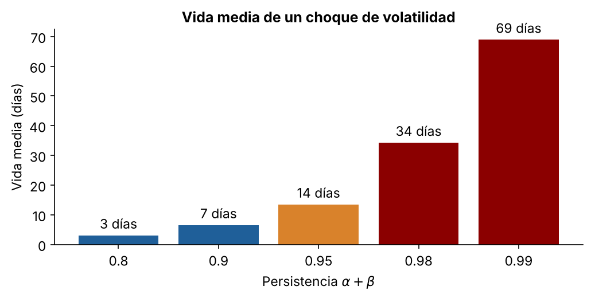{fig-align="center" width="65%"}

- En series financieras diarias es habitual encontrar $\alpha+\beta \approx 0.97$–$0.99$: los episodios de alta volatilidad duran **semanas o meses**.

## Simulación: ARCH(1) vs. GARCH(1,1)

- La diferencia entre ambos es el término $\beta\,\sigma_{t-1}^2$: el GARCH agrega memoria de la varianza pasada.

```{python}
#| eval: false
def simular_garch(n, omega, alpha, beta=0, semilla=4):
    rng = np.random.default_rng(semilla)
    z = rng.standard_normal(n)
    resid, varianza = np.zeros(n), np.zeros(n)
    for t in range(1, n):
        varianza[t] = omega + alpha * resid[t - 1] ** 2 + beta * varianza[t - 1]
        resid[t] = np.sqrt(varianza[t]) * z[t]
    return resid, varianza


arch_resid, arch_var = simular_garch(200, omega=0.1, alpha=0.7)  # ARCH(1)
garch_resid, garch_var = simular_garch(
    200, omega=0.1, alpha=0.7, beta=0.1
)  # GARCH(1,1)
```

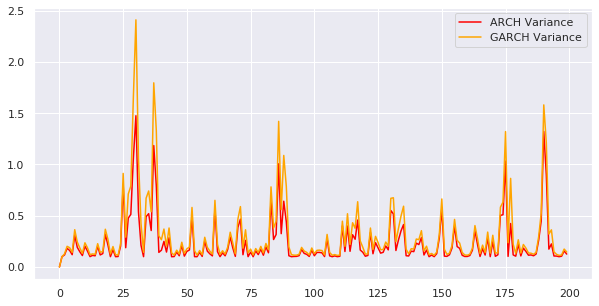{fig-align="center" width="75%"}

## Efecto del parámetro $\beta$

- Dos GARCH(1,1) con el mismo $\omega = 0.1$ y $\alpha = 0.3$, pero distinto $\beta$:

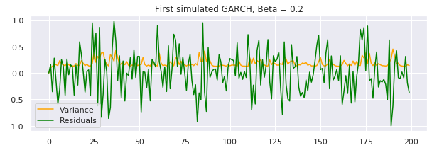{fig-align="center" width="80%"}

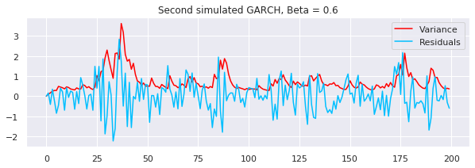{fig-align="center" width="80%"}

::: {.callout-tip}
A mayor $\alpha$, mayor el **impacto inmediato** de un choque; a mayor $\beta$, mayor la **duración** de ese impacto.
:::

## Verificar si la serie tiene varianza condicional

- Si es una serie de precios, realizar el análisis sobre sus **retornos**: `retornos = 100 * serie.pct_change().dropna()`
- Verificar la distribución de los retornos: **colas pesadas** y alta variabilidad.
- Estimar la volatilidad con la **desviación estándar en una ventana móvil**: `volatilidad_movil = retornos.rolling(ventana).std()`. Picos o clústeres son indicio de heterocedasticidad.
- Aplicar la prueba Ljung-Box sobre los retornos al cuadrado: indica si la varianza está correlacionada con sus rezagos.
- Realizar el test formal **ARCH LM**. El test prueba si los parámetros $\alpha_1, \alpha_2, \ldots, \alpha_j$ de la regresión:

$$
e^2_t = \alpha_0 + \alpha_1 e^2_{t-1} + \alpha_2 e^2_{t-2} + \ldots + \alpha_j e^2_{t-j} + u_t
$$

son conjuntamente significativos mediante el estadístico multiplicador de Lagrange $LM = T \cdot R^2 \sim \chi^2_j$, con $H_0: \alpha_1 = \alpha_2 = \ldots = \alpha_j = 0$ y $H_1$: al menos un $\alpha_i \neq 0$.

## Flujograma de detección ARCH/GARCH

```{mermaid}
%%| fig-width: 9
flowchart TD
    A["Serie de tiempo en retornos"] --> B["Inspección visual de std móvil"]
    B -->|Plana| V1["Varianza constante<br/>(no necesita ARCH/GARCH)"]
    B -->|Picos| C["Ljung-Box sobre y²"]
    C -->|"p ≥ 0.05"| V2["Varianza constante"]
    C -->|"p < 0.05"| D["Test ARCH LM"]
    D -->|"p ≥ 0.05"| V3["Varianza constante"]
    D -->|"p < 0.05"| G["Usar ARCH/GARCH"]

    classDef ok fill:#e8f1fb,stroke:#1f77b4,color:#1f3b57
    classDef alerta fill:#fbeaea,stroke:#8B0000,color:#5a0000
    classDef paso fill:#f5f5f5,stroke:#666,color:#222
    class V1,V2,V3 ok
    class G alerta
    class A,B,C,D paso
```

## Pruebas en Python

```{python}
from statsmodels.stats.diagnostic import acorr_ljungbox, het_arch

ventana = 21
volatilidad_movil = retornos.rolling(ventana).std()

fig, ax = plt.subplots(figsize=(15, 4))
ax.plot(volatilidad_movil, color="darkred")
ax.set_title(f"Desviación estándar móvil ({ventana} días)")
ax.set_ylabel("%")
plt.show()

residuos = retornos - retornos.mean()

print(acorr_ljungbox(residuos**2, lags=[10, 20], return_df=True))

lm_stat, lm_p, f_stat, f_p = het_arch(residuos, nlags=10)
print(f"ARCH LM: estadístico = {lm_stat:.2f}, p-valor = {lm_p:.4e}")
```

# Especificación y estimación

## Familia de modelos ARCH

- Los modelos ARCH son una clase de modelos de volatilidad que usan los valores observados de rendimientos o residuos como choques de volatilidad. Un modelo GARCH básico se especifica como:

$$
\begin{aligned}
r_t &= \mu + \epsilon_t \\
\epsilon_t &= \sigma_t e_t \\
\sigma^2_t &= \omega + \alpha \epsilon_{t-1}^2 + \beta \sigma^2_{t-1} \\
e_t &\sim D(\cdot)
\end{aligned}
$$

- Un modelo ARCH completo tiene tres componentes:
  1. Un modelo de media (por ejemplo, media constante).
  2. Un proceso de volatilidad (ARCH, GARCH, GJR-GARCH, EGARCH, ...).
  3. Una distribución para los residuos estandarizados (normal, t de Student, t asimétrica, ...).
- La combinación de estos componentes genera distintos modelos. Por ejemplo, el GARCH(1, 1) clásico tiene $\mu$ constante y residuos con distribución normal.

## Supuestos sobre la especificación de la media 

- La volatilidad no es observable: el GARCH usa los **residuos** de la ecuación de media como choques de volatilidad. Si la media está mal especificada, la volatilidad también lo estará.

| Especificación | `arch_model(mean=...)` | Cuándo usarla |
|---|---|---|
| Media constante | `"Constant"` | Funciona bien con la mayoría de retornos financieros |
| Autorregresiva | `"AR"` (con `lags=`) | Cuando los retornos tienen autocorrelación en nivel |
| Media cero | `"Zero"` | Cuando la media se modeló por separado (p. ej. ARMA) y se ajusta el GARCH sobre sus residuos |

- **Estrategia en dos etapas** (recomendada cuando hay autocorrelación en nivel):
  1. Ajustar un ARMA a los retornos y seleccionar los órdenes por BIC.
  2. Ajustar un GARCH con `mean="Zero"` sobre los residuos del ARMA.

## Estimación GARCH(1,1): Alphabet (GOOGL) 

```{python}
from arch import arch_model

basico = arch_model(retornos, p=1, q=1, mean="Constant", vol="GARCH", dist="normal")
res_basico = basico.fit(disp="off")

alpha1, beta1, omega = res_basico.params[["alpha[1]", "beta[1]", "omega"]]
persistencia = alpha1 + beta1
var_largo_plazo = omega / (1 - persistencia)
vida_media = np.log(0.5) / np.log(persistencia)

pd.DataFrame(
    {
        "Estimación": res_basico.params,
        "t": res_basico.tvalues,
        "p-valor": res_basico.pvalues,
    }
).round(4)
```

- Persistencia: $\alpha_1+\beta_1 =$ `{python} f"{persistencia:.3f}"`; vida media de un choque $\approx$ `{python} f"{vida_media:.0f}"` días.
- Varianza de largo plazo $\bar\sigma^2 =$ `{python} f"{var_largo_plazo:.2f}"`, es decir $\bar\sigma \approx$ `{python} f"{np.sqrt(var_largo_plazo):.2f}"` % diario (`{python} f"{np.sqrt(252 * var_largo_plazo):.1f}"` % anual).

```{python}
fig, axes = plt.subplots(2, 1, figsize=(15, 5), sharex=True)
axes[0].plot(res_basico.std_resid, color="steelblue", lw=0.6)
axes[0].set_title("Residuos estandarizados")
axes[1].plot(res_basico.conditional_volatility, color="darkred", lw=0.8)
axes[1].set_title("Volatilidad condicional estimada (%)")
plt.tight_layout()
plt.show()
```

## Supuestos de distribución 

- Residuo: $\epsilon_t = r_t - \mu_t$. **Residuo estandarizado**: $z_t = \epsilon_t / \sigma_t$.
- Por defecto se supone $z_t \sim N(0,1)$, pero los retornos financieros tienen **más valores extremos** de lo que predice la normal.
- Alternativas en `arch_model(dist=...)`:
  - `"t"`: t de Student, simétrica y de colas pesadas; los grados de libertad $\nu$ controlan el grosor de las colas (menor $\nu$, colas más pesadas).
  - `"skewt"`: t asimétrica, agrega un parámetro de sesgo.
  - `"ged"`: distribución de error generalizada.

```{python}
z = res_basico.std_resid  # residuos estandarizados del GARCH normal
res_skewt = arch_model(
    retornos, p=1, q=1, mean="Constant", vol="GARCH", dist="skewt"
).fit(disp="off")

x = np.linspace(-6, 6, 400)
fig, axes = plt.subplots(1, 2, figsize=(15, 4))
axes[0].hist(
    z,
    bins=80,
    density=True,
    color="indianred",
    alpha=0.6,
    label="Residuos estandarizados",
)
axes[0].plot(x, stats.norm.pdf(x), color="black", label="N(0, 1)")
axes[0].set_xlim(-6, 6)
axes[0].set_title("GARCH normal: residuos estandarizados vs. N(0, 1)")
axes[0].legend()
axes[1].plot(retornos, color="grey", alpha=0.4, label="Retornos diarios")
axes[1].plot(
    res_skewt.conditional_volatility,
    color="red",
    label="Volatilidad GARCH t asimétrica",
)
axes[1].set_title("Volatilidad estimada con t asimétrica")
axes[1].legend(loc="upper right")
plt.tight_layout()
plt.show()
```

## Enfoque en dos etapas: ARMA + GARCH 

```{python}
import pmdarima as pm
import statsmodels.api as sm

# Etapa 1: ecuación de media (ARMA) sobre los log-retornos de GOOGL, por BIC
arma = pm.auto_arima(
    log_retornos,
    d=0,
    start_p=1,
    start_q=1,
    max_p=4,
    max_q=4,
    seasonal=False,
    information_criterion="bic",
    stepwise=True,
)
res_arma = sm.tsa.SARIMAX(log_retornos, order=arma.order).fit(disp=False)

# Etapa 2: GARCH(1,1) con media cero sobre los residuos del ARMA
res_arma_garch = arch_model(res_arma.resid, mean="Zero", p=1, q=1).fit(disp="off")
res_arma_garch.params.round(4).to_frame(f"GARCH(1,1) sobre ARMA{arma.order}")
```

```{python}
res_arma.plot_diagnostics(figsize=(15, 6))
plt.tight_layout()
plt.show()
```

- Orden elegido por BIC: ARMA`{python} str(arma.order)`. Si los residuos del ARMA no tienen autocorrelación pero sí colas pesadas y agrupamiento, la dependencia restante está en la **varianza**: ahí entra el GARCH.

## Diagnóstico del modelo ajustado 

**1. Significancia de los parámetros**: $H_0: \theta = 0$. Se rechaza si p-valor $< 0.05$ o $|t| > 2$, con $t = \hat\theta / se(\hat\theta)$ (tabla de la estimación). Un modelo parsimonioso elimina los parámetros no significativos.

**2. Ljung-Box sobre los residuos estandarizados**: $H_0$ = los datos son independientes. Si p-valor $< 0.05$, el modelo no capturó toda la dependencia.

- En $z_t$: dependencia remanente en la **media** (sugiere un ARMA para la media).
- En $z_t^2$: efectos **ARCH** remanentes (sugiere más rezagos o otro modelo de volatilidad).

```{python}
lb = (
    pd.DataFrame(
        {
            "p-valor z_t": acorr_ljungbox(z, lags=10)["lb_pvalue"],
            "p-valor z_t²": acorr_ljungbox(z**2, lags=10)["lb_pvalue"],
        }
    )
    .round(3)
    .rename_axis("Rezago")
)
lb
```

## Bondad de ajuste y selección de modelos 

- **Máxima verosimilitud**: los parámetros se eligen para maximizar la probabilidad de observar los datos bajo el modelo supuesto. Se prefiere el modelo con **mayor log-verosimilitud**.
- **Criterios de información**: penalizan la complejidad; se prefiere el **menor** AIC/BIC.

$$
AIC = -2\ln L + 2k \qquad\qquad BIC = -2\ln L + k\ln T
$$

```{python}
dif_ll = res_skewt.loglikelihood - res_basico.loglikelihood
pd.DataFrame(
    {
        "Log-verosimilitud": [res_basico.loglikelihood, res_skewt.loglikelihood],
        "AIC": [res_basico.aic, res_skewt.aic],
        "BIC": [res_basico.bic, res_skewt.bic],
    },
    index=["GARCH(1,1) normal", "GARCH(1,1) t asimétrica"],
).round(2)
```

- Con dos parámetros adicionales, la t asimétrica cambia la log-verosimilitud en `{python} f"{dif_ll:+.1f}"` puntos: en retornos financieros las colas pesadas suelen mejorar el ajuste.

# Asimetría en la volatilidad

## Efecto apalancamiento

- Razón deuda/patrimonio $= \text{Deuda} / \text{Patrimonio}$: cuando el precio de la acción cae, el patrimonio cae, la razón sube y la empresa se vuelve **más riesgosa**.
- El GARCH supone que las noticias positivas y negativas tienen un impacto **simétrico** sobre la volatilidad (depende de $\epsilon_{t-1}^2$).
- En la práctica, el mercado "sube por las escaleras y baja por el ascensor": las malas noticias aumentan más la volatilidad.

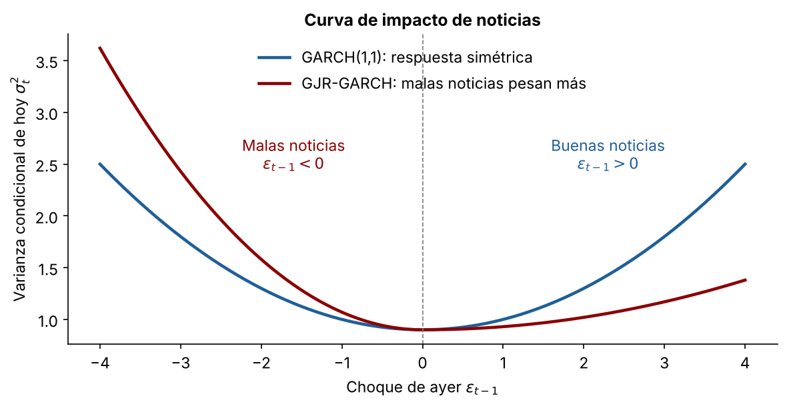{fig-align="center" width="70%"}

## Modelo GJR-GARCH

- Glosten, Jagannathan y Runkle (1993) incorporan el **efecto apalancamiento**: las malas noticias ($\epsilon_{t-1} < 0$) aumentan más la volatilidad que las buenas noticias de igual magnitud.

$$
\begin{aligned}
\sigma_t^2 &= \omega + \left(\alpha + \gamma I_{t-1}\right) \epsilon_{t-1}^2 + \beta \sigma_{t-1}^2 \\
I_{t-1} &= \begin{cases} 1 & \text{si } \epsilon_{t-1} < 0 \\ 0 & \text{si } \epsilon_{t-1} \geq 0 \end{cases}
\end{aligned}
$$

- Impacto de una noticia positiva: $\alpha$. Impacto de una noticia negativa: $\alpha + \gamma$.
- $\gamma > 0$ indica asimetría (efecto apalancamiento).
- Estacionariedad (distribución simétrica): $\alpha + \gamma/2 + \beta < 1$.
- En la librería `arch`: `arch_model(retornos, p=1, o=1, q=1)`.

## Estimación en Python

```{python}
from arch import arch_model

# GARCH(1,1) y GJR-GARCH(1,1) con errores t sobre los retornos de GOOGL
garch = arch_model(retornos, mean="Constant", vol="GARCH", p=1, q=1, dist="t").fit(
    disp="off"
)
gjr = arch_model(retornos, mean="Constant", vol="GARCH", p=1, o=1, q=1, dist="t").fit(
    disp="off"
)

print(garch.summary())
print(gjr.summary())

comparacion = pd.DataFrame(
    {
        "AIC": [garch.aic, gjr.aic],
        "BIC": [garch.bic, gjr.bic],
    },
    index=["GARCH(1,1)", "GJR-GARCH(1,1)"],
)
print(comparacion)

fig, ax = plt.subplots(figsize=(15, 4))
ax.plot(garch.conditional_volatility, label="GARCH(1,1)", color="steelblue")
ax.plot(gjr.conditional_volatility, label="GJR-GARCH(1,1)", color="darkred", alpha=0.7)
ax.set_title("Volatilidad condicional estimada: Alphabet (GOOGL)")
ax.set_ylabel("%")
ax.legend()
plt.show()
```

## Modelo EGARCH 

- El GARCH exponencial de Nelson (1991) modela el **logaritmo** de la varianza. En la especificación de la librería `arch`, con $e_t = \epsilon_t/\sigma_t$:

$$
\ln \sigma_t^2 = \omega + \sum_{i=1}^{p} \alpha_i\left(|e_{t-i}| - \sqrt{2/\pi}\right) + \sum_{k=1}^{o} \gamma_k\, e_{t-k} + \sum_{j=1}^{q} \beta_j \ln \sigma_{t-j}^2
$$

- $\alpha_i$: efecto de **magnitud** del choque. $\gamma_k$: efecto de **signo**; $\gamma < 0$ implica que los choques negativos elevan más la volatilidad.
- Al modelar $\ln\sigma_t^2$, la varianza siempre es positiva: **no se requieren restricciones de no negatividad** sobre los parámetros, lo que facilita la estimación.
- La persistencia la determina $\beta$.
- En la librería `arch`: `arch_model(retornos, p=1, o=1, q=1, vol="EGARCH")`.

## Caso de estudio: Bitcoin 

- Los mercados de criptomonedas reaccionan de forma muy distinta a noticias positivas y negativas: buen candidato para modelos asimétricos.

:::: {.columns}
::: {.column width="50%"}
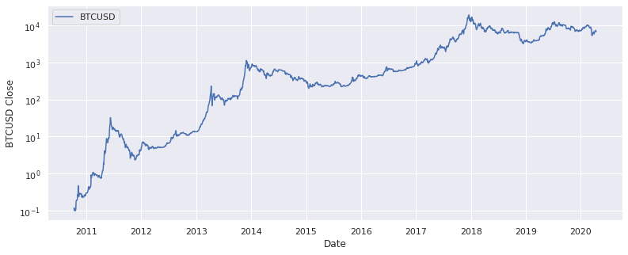{width="100%"}
:::
::: {.column width="50%"}
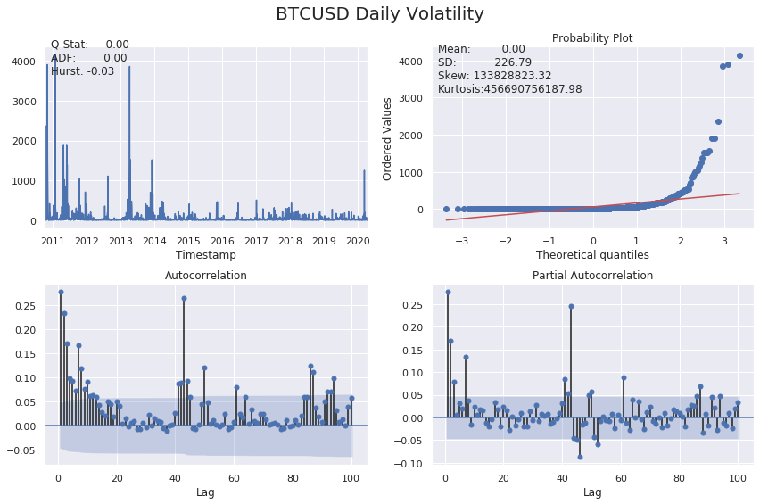{width="100%"}
:::
::::

```{python}
#| eval: false
# Precio de Bitcoin desde la API de Blockchain.com (fuente del cuaderno)
url = (
    "https://api.blockchain.info/charts/market-price"
    "?start=2010-10-09&timespan=12years&format=csv"
)
btc = pd.read_csv(url, names=["Fecha", "Close"], index_col="Fecha", parse_dates=True)
btc = btc.loc[btc["Close"] > 0].loc[:"2020-04-13"]  # mismo periodo del cuaderno
btc_retornos = 100 * np.log(btc["Close"]).diff().dropna()  # log-retornos en %

gjr_btc = arch_model(btc_retornos, p=1, o=1, q=1, vol="GARCH", dist="t").fit(disp="off")
egarch_btc = arch_model(btc_retornos, p=1, o=1, q=1, vol="EGARCH", dist="t").fit(
    disp="off"
)
print(pd.Series({"GJR-GARCH": gjr_btc.bic, "EGARCH": egarch_btc.bic}, name="BIC"))
```

## GJR-GARCH vs. EGARCH en Bitcoin

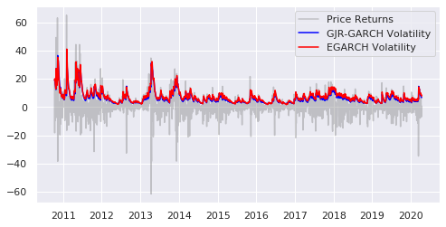{fig-align="center" width="75%"}

| Modelo | BIC |
|---|---|
| GJR-GARCH(1,1,1) t | 10779.4 |
| EGARCH(1,1,1) t | **10754.4** |

- Ambos modelos siguen de cerca los datos; el GJR-GARCH es algo más conservador, pero el **EGARCH tiene menor BIC** y es el modelo preferido.

# Pronóstico y evaluación

## Pronóstico de volatilidad con GARCH 

- Por defecto, `.forecast()` produce el pronóstico a **1 paso**; con `horizon=h` se obtienen horizontes más largos.
- Para el GARCH(1,1), el pronóstico a $h$ pasos revierte geométricamente a la varianza de largo plazo:

$$
E_t\!\left[\sigma^2_{t+h}\right] = \bar\sigma^2 + (\alpha+\beta)^{h-1}\left(\sigma^2_{t+1} - \bar\sigma^2\right)
$$

```{python}
pronostico = res_basico.forecast(horizon=5)  # GARCH(1,1) de GOOGL
fecha_origen = pronostico.variance.index[-1]
sigma_1 = np.sqrt(pronostico.variance.iloc[-1, 0])
pronostico.variance.iloc[-1:].round(3)
```

- `h.1` es el pronóstico a 1 paso hecho con datos **hasta `{python} f"{fecha_origen:%Y-%m-%d}"` inclusive**: $\sigma_{t+1} \approx$ `{python} f"{sigma_1:.2f}"` % diario frente a $\bar\sigma \approx$ `{python} f"{np.sqrt(var_largo_plazo):.2f}"` %. Los siguientes horizontes se acercan gradualmente al largo plazo.

## Reversión a la media del pronóstico

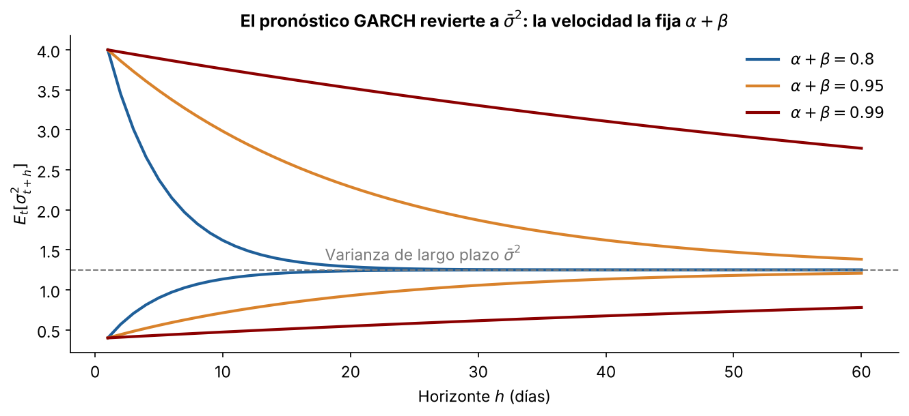{fig-align="center" width="80%"}

- Con $\alpha+\beta$ cercano a 1, un choque de volatilidad **tarda mucho en disiparse**; si $\alpha+\beta = 1$ (IGARCH) el pronóstico nunca revierte.

## Ventana expansiva vs. ventana móvil 

:::: {.columns}
::: {.column width="50%"}
- **Ventana expansiva**: se agregan continuamente nuevas observaciones a la muestra.
- **Ventana móvil fija**: se agregan observaciones nuevas y se descartan las más antiguas.
- Ventajas del pronóstico con ventanas:
  - Evita el sesgo de mirar al futuro (*look-ahead bias*).
  - Menos propenso al sobreajuste.
  - Adapta el pronóstico a las nuevas observaciones.
:::
::: {.column width="50%"}
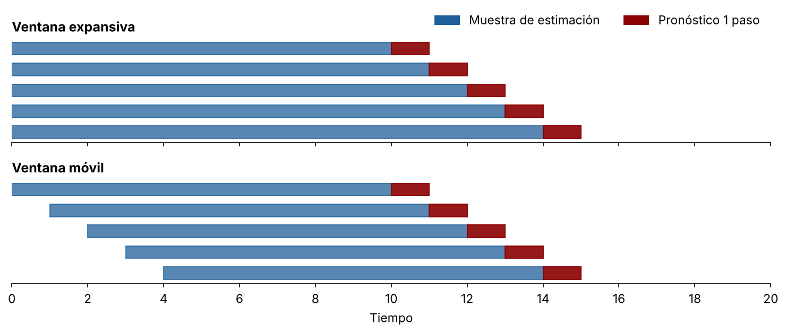{width="100%"}
:::
::::

- **¿Qué tamaño de ventana?** Se decide caso a caso: una ventana muy amplia incluye datos obsoletos (**más sesgo**); una muy estrecha excluye datos relevantes (**más varianza**). El tamaño óptimo balancea ambos.

## Pronóstico con ventanas en Python 

- Pronóstico a 1 paso de la volatilidad de GOOGL durante el choque COVID-19 (enero–junio de 2020):

```{python}
modelo = arch_model(retornos, mean="Constant", p=1, q=1)
inicio_oos = retornos.index.searchsorted(pd.Timestamp("2020-01-01"))
fin_oos = retornos.index.searchsorted(pd.Timestamp("2020-07-01"))
pron_movil, pron_expansiva = {}, {}

for t in range(inicio_oos, fin_oos):
    # Ventana móvil: inicio y fin avanzan juntos. Ventana expansiva: el inicio queda fijo.
    for inicio, destino in ((t - inicio_oos, pron_movil), (0, pron_expansiva)):
        res = modelo.fit(first_obs=inicio, last_obs=t, disp="off")
        destino[retornos.index[t]] = res.forecast(
            horizon=1, reindex=False
        ).variance.iloc[0, 0]

vol_movil = np.sqrt(pd.Series(pron_movil))
vol_expansiva = np.sqrt(pd.Series(pron_expansiva))

fig, ax = plt.subplots(figsize=(15, 5))
ax.plot(retornos.loc[vol_movil.index], color="grey", label="Retorno diario")
ax.plot(vol_expansiva, color="blue", label="Ventana expansiva")
ax.plot(vol_movil, color="red", label="Ventana móvil")
ax.set_ylabel("%")
ax.legend()
plt.show()
```

- Cada pronóstico usa solo la información disponible el día anterior: no hay sesgo de mirar al futuro.

## Backtesting: MAE y MSE 

- La volatilidad no es observable; un proxy habitual de la varianza realizada es el retorno al cuadrado $(r_t - \bar r)^2$.

$$
MAE = \frac{1}{T}\sum_{t=1}^{T}\left|\hat\sigma^2_t - (r_t-\bar r)^2\right| \qquad MSE = \frac{1}{T}\sum_{t=1}^{T}\left(\hat\sigma^2_t - (r_t-\bar r)^2\right)^2
$$

```{python}
#| eval: false
from sklearn.metrics import mean_absolute_error, mean_squared_error

proxy = btc_retornos.sub(btc_retornos.mean()).pow(2)  # varianza "realizada" de BTC
var_egarch = egarch_btc.conditional_volatility**2
mae = mean_absolute_error(proxy, var_egarch)
mse = mean_squared_error(proxy, var_egarch)
```

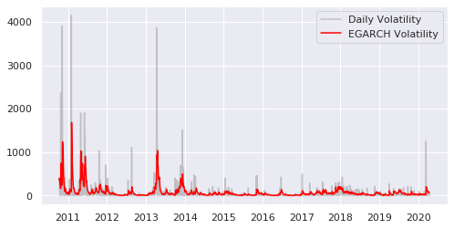{fig-align="center" width="65%"}

::: {.callout-warning}
El retorno al cuadrado es un proxy **muy ruidoso**; los errores sirven para **comparar modelos** entre sí, preferiblemente fuera de muestra.
:::

## Pronósticos por simulación y *bootstrap* 

- **Simulación**: genera trayectorias futuras con choques de la distribución supuesta de $z_t$.
- **Bootstrap**: igual, pero los choques se remuestrean de los **residuos estandarizados históricos**; no depende del supuesto distribucional.

```{python}
#| eval: false
sim = egarch_btc.forecast(horizon=5, method="simulation")  # EGARCH-t de Bitcoin
bs = egarch_btc.forecast(horizon=5, method="bootstrap")
trayectorias_sim = sim.simulations.residual_variances[-1].T
trayectorias_bs = bs.simulations.residual_variances[-1].T
```

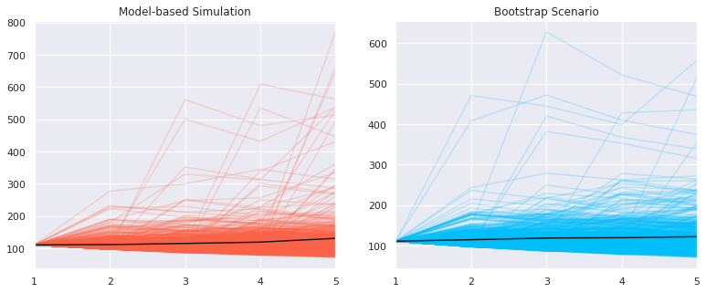{fig-align="center" width="85%"}

# Aplicaciones en gestión de riesgo

## Valor en Riesgo (VaR) 

:::: {.columns}
::: {.column width="45%"}
- **Tres ingredientes**: portafolio, horizonte temporal y probabilidad.
- **VaR 5 % a 1 día de USD 1 millón**: hay 5 % de probabilidad de que el portafolio pierda USD 1 millón o más en un día.
- **VaR 1 % a 10 días de USD 9 millones**: hay 1 % de probabilidad de perder USD 9 millones o más en 10 días.
- **Excedencia**: la pérdida supera el VaR. Con un VaR del 5 % y 252 días, un modelo válido debería tener ≈ 13 excedencias al año ($0.05 \times 252$). Más excedencias implican que el modelo **subestima** el riesgo.
:::
::: {.column width="55%"}
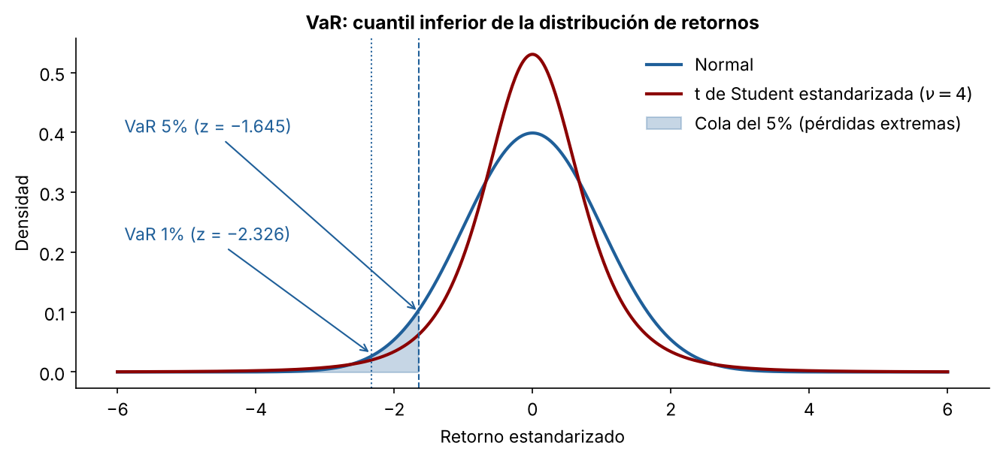{width="100%"}
:::
::::

## VaR dinámico con GARCH 

$$
\text{VaR}_{t+1}^{\alpha} = -\left(\mu_{t+1} + \sigma_{t+1}\, q_\alpha\right)
$$

- $\mu_{t+1}$ y $\sigma_{t+1}$ provienen del pronóstico GARCH; $q_\alpha$ es el cuantil $\alpha$ de los residuos estandarizados.
- **VaR paramétrico**: $q_\alpha$ de la distribución **supuesta** por el modelo.
- **VaR empírico** (simulación histórica filtrada): $q_\alpha$ de la distribución **observada** de los $z_t$.

```{python}
#| eval: false
# EGARCH-t de Bitcoin estimado hasta 2018 y pronóstico fuera de muestra desde 2019
am = arch_model(btc_retornos, p=1, o=1, q=1, vol="EGARCH", dist="t")
res = am.fit(disp="off", last_obs="2018-01-01")
f = res.forecast(start="2019-01-01", reindex=False)
media, varianza = f.mean.loc["2019":], f.variance.loc["2019":]

q_param = am.distribution.ppf([0.01, 0.05], res.params[["nu"]].values)  # paramétrico
z = res.resid / res.conditional_volatility
q_emp = z.quantile([0.01, 0.05]).values  # empírico

var_param = pd.DataFrame(
    -media.values - np.sqrt(varianza).values * q_param[None, :],
    index=varianza.index,
    columns=["1%", "5%"],
)
var_emp = pd.DataFrame(
    -media.values - np.sqrt(varianza).values * q_emp[None, :],
    index=varianza.index,
    columns=["1%", "5%"],
)
```

| Cuantil | Paramétrico (t) | Empírico |
|---|---|---|
| $q_{1\%}$ | −2.636 | −2.566 |
| $q_{5\%}$ | −1.382 | −1.307 |

## VaR paramétrico vs. empírico: Bitcoin 

:::: {.columns}
::: {.column width="50%"}
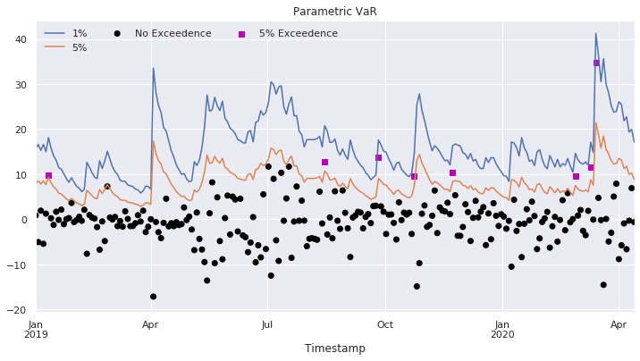{width="100%"}
:::
::: {.column width="50%"}
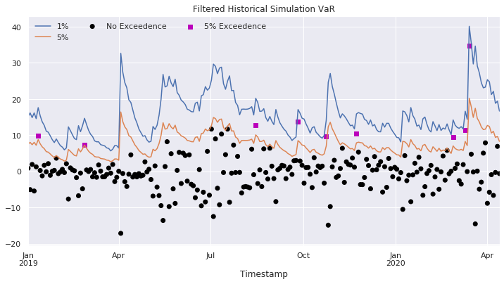{width="100%"}
:::
::::

- Puntos negros: sin excedencia; cuadrados morados: excedencia del VaR 5 %; cruces rojas: excedencia del VaR 1 %.
- Después de un choque, el VaR **se ajusta inmediatamente** al alza: esa es la ventaja frente a un VaR con varianza constante.

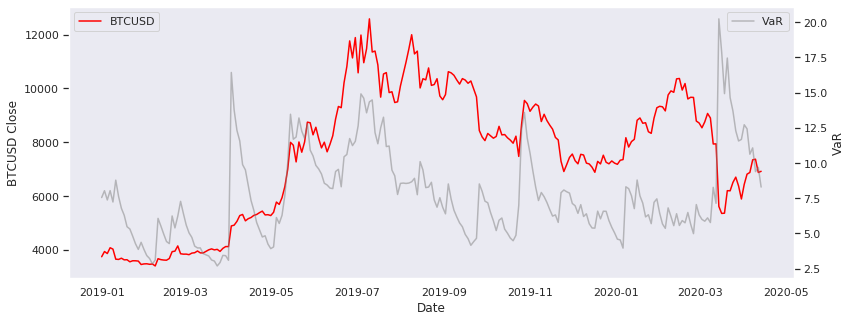{fig-align="center" width="75%"}

## Covarianza dinámica con GARCH 

- La covarianza describe cómo se mueven conjuntamente dos activos: positiva si se mueven juntos, negativa si se mueven en direcciones opuestas.
- Con volatilidades GARCH y correlación constante $\rho$ (modelo CCC, Bollerslev, 1990):

$$
\text{Cov}_t = \rho\,\sigma_{1,t}\,\sigma_{2,t}
$$

1. Ajustar un GARCH a cada serie y obtener $\sigma_{1,t}$ y $\sigma_{2,t}$.
2. Calcular los residuos estandarizados $z_{i,t} = \epsilon_{i,t}/\sigma_{i,t}$.
3. Estimar $\rho$ como la correlación entre $z_{1,t}$ y $z_{2,t}$.
4. Multiplicar: $\text{Cov}_t = \rho\,\sigma_{1,t}\,\sigma_{2,t}$.

- Ejemplo: **GOOGL** con **TMF** (bonos del Tesoro de EE. UU. a 20+ años, apalancados ×3); el S&P 500 (**SPY**) se usa como mercado en el beta.

```{python}
activos = ["GOOGL", "TMF", "SPY"]
px = yf.download(
    activos, start="2010-01-01", end="2025-01-01", auto_adjust=True, progress=False
)["Close"]
lr = 100 * np.log(px).diff().dropna()

# Paso 1: EGARCH-t con media cero para cada activo
res_activos = {
    a: arch_model(lr[a], mean="Zero", p=1, o=1, q=1, vol="EGARCH", dist="t").fit(
        disp="off"
    )
    for a in activos
}
vol = pd.DataFrame({a: r.conditional_volatility for a, r in res_activos.items()})
z_activos = lr / vol  # Paso 2: residuos estandarizados
rho = z_activos["GOOGL"].corr(z_activos["TMF"])  # Paso 3: correlación constante
cov_t = rho * vol["GOOGL"] * vol["TMF"]  # Paso 4: covarianza dinámica

fig, axes = plt.subplots(1, 2, figsize=(15, 4))
(px / px.iloc[0]).plot(ax=axes[0], title="Precios normalizados", logy=True)
axes[1].plot(cov_t, color="red", lw=0.8)
axes[1].set_title(f"Covarianza GARCH GOOGL–TMF (ρ = {rho:.2f})")
plt.tight_layout()
plt.show()
```

## Varianza dinámica del portafolio 

- Para un portafolio de dos activos con pesos $w_1$ y $w_2$:

$$
\sigma^2_{p,t} = w_1^2\,\sigma^2_{1,t} + w_2^2\,\sigma^2_{2,t} + 2\,w_1 w_2\,\text{Cov}_t
$$

- La Teoría Moderna de Portafolios usa la diversificación para alcanzar un retorno esperado con el **mínimo riesgo**. Con GARCH, ese riesgo se actualiza día a día.

```{python}
# Peso de GOOGL que maximiza el Sharpe histórico (cálculo vectorizado)
w = np.linspace(0, 1, 101)
ret_port = np.outer(lr["GOOGL"], w) + np.outer(lr["TMF"], 1 - w)
sharpe = ret_port.mean(axis=0) / ret_port.std(axis=0) * np.sqrt(252)
w_googl = w[sharpe.argmax()]
w_tmf = 1 - w_googl

var_portafolio = (
    w_googl**2 * vol["GOOGL"] ** 2
    + w_tmf**2 * vol["TMF"] ** 2
    + 2 * w_googl * w_tmf * cov_t
)

fig, axes = plt.subplots(1, 2, figsize=(15, 4))
axes[0].plot(100 * w, sharpe)
axes[0].axvline(100 * w_googl, color="grey", ls="--")
axes[0].set(
    title="Sharpe anualizado según el peso de GOOGL",
    xlabel="% en GOOGL",
    ylabel="Sharpe",
)
axes[1].plot(vol["GOOGL"], color="grey", alpha=0.6, lw=0.8, label="Solo GOOGL")
axes[1].plot(
    np.sqrt(var_portafolio),
    color="deepskyblue",
    lw=0.8,
    label=f"Portafolio {100 * w_googl:.0f}% GOOGL / {100 * w_tmf:.0f}% TMF",
)
axes[1].set(title="Volatilidad condicional diaria (%)")
axes[1].legend()
plt.tight_layout()
plt.show()
```

::: {.callout-note}
Si la correlación cambia en el tiempo, el modelo DCC (*Dynamic Conditional Correlation*, Engle, 2002) generaliza este enfoque con $\rho_t$ variable.
:::

## Beta dinámico 

- **Beta**: sensibilidad de un activo frente al mercado; mide el **riesgo sistemático**, la parte del riesgo que no se puede diversificar.
  - $\beta = 1$: se mueve como el mercado (referencia).
  - $\beta > 1$: más riesgo que el mercado. $\beta < 1$: menos riesgo que el mercado.
- Con GARCH: $\beta_t = \rho\,\dfrac{\sigma_{\text{activo},t}}{\sigma_{\text{mercado},t}}$

```{python}
rho_mercado = z_activos["GOOGL"].corr(z_activos["SPY"])  # S&P 500 como mercado
beta_googl = rho_mercado * vol["GOOGL"] / vol["SPY"]

fig, ax = plt.subplots(figsize=(15, 4))
ax.plot(beta_googl, lw=0.8)
ax.axhline(1, color="grey", ls="--", label="Mercado (β = 1)")
ax.set_title("Beta dinámico de GOOGL frente al S&P 500 (EGARCH-t)")
ax.legend()
plt.show()
```

- Beta promedio de GOOGL: `{python} f"{beta_googl.mean():.2f}"`. Cuando la volatilidad propia de GOOGL sube más que la del mercado, su beta aumenta.

# Cierre

## Resumen 

1. Los retornos financieros son poco autocorrelacionados en nivel, pero su **magnitud** muestra dependencia: **agrupamiento de volatilidad**.
2. **ARCH** modela la varianza condicional con choques pasados; **GARCH** agrega varianzas pasadas y logra persistencia con pocos parámetros.
3. Un modelo completo combina **media + volatilidad + distribución**; las colas pesadas (t, t asimétrica) suelen mejorar el ajuste.
4. **GJR-GARCH** y **EGARCH** capturan la respuesta asimétrica ante malas noticias.
5. Diagnóstico: significancia de parámetros, Ljung-Box sobre $z_t$ y $z_t^2$, log-verosimilitud, AIC/BIC y backtesting fuera de muestra.
6. Aplicaciones: **pronóstico de volatilidad, VaR dinámico, covarianza, varianza de portafolio y beta dinámico**.

## Ejemplos resueltos

- Ver cuadernos de Jupyter en Python/R

## Referencias 

- Bollerslev, T. (1986). Generalized autoregressive conditional heteroskedasticity. *Journal of Econometrics*, 31(3), 307–327.
- Bollerslev, T. (1990). Modelling the coherence in short-run nominal exchange rates: A multivariate generalized ARCH model. *The Review of Economics and Statistics*, 72(3), 498–505.
- Bollerslev, T. (2023). Reprint of: Generalized autoregressive conditional heteroskedasticity. *Journal of Econometrics*, 234, 25–37. https://doi.org/10.1016/j.jeconom.2023.02.001
- Diebold, F. X. (2017). *Forecasting in Economics, Business, Finance and Beyond*. University of Pennsylvania.
- Engle, R. F. (1982). Autoregressive conditional heteroscedasticity with estimates of the variance of United Kingdom inflation. *Econometrica*, 50(4), 987–1007.
- Engle, R. (2001). GARCH 101: The use of ARCH/GARCH models in applied econometrics. *Journal of Economic Perspectives*, 15(4), 157–168.
- Engle, R. (2002). Dynamic conditional correlation: A simple class of multivariate generalized autoregressive conditional heteroskedasticity models. *Journal of Business & Economic Statistics*, 20(3), 339–350.
- Glosten, L. R., Jagannathan, R., & Runkle, D. E. (1993). On the relation between the expected value and the volatility of the nominal excess return on stocks. *The Journal of Finance*, 48(5), 1779–1801.
- Hyndman, R. J., & Athanasopoulos, G. (2021). *Forecasting: Principles and Practice* (3rd ed.). OTexts. https://otexts.com/fpp3/
- Mandelbrot, B. (1963). The variation of certain speculative prices. *The Journal of Business*, 36(4), 394–419.
- McNeil, A. J., Frey, R., & Embrechts, P. (2005). *Quantitative Risk Management: Concepts, Techniques and Tools*. Princeton University Press.
- Nelson, D. B. (1991). Conditional heteroskedasticity in asset returns: A new approach. *Econometrica*, 59(2), 347–370.
- Sheppard, K. *arch: Autoregressive Conditional Heteroskedasticity models in Python*. https://arch.readthedocs.io
