# Prophet — Modelo de Pronóstico de Meta {background-color="#4a1942"}

## Estacionalidad compleja

- Hasta ahora hemos trabajado principalmente con patrones relativamente simples, como los de datos trimestrales y mensuales.
- Las series de mayor frecuencia suelen presentar patrones estacionales más complicados. Por ejemplo, una serie diaria puede tener al mismo tiempo un patrón semanal y otro anual.
- Los métodos no lineales que estudiaremos en este tema permiten modelar y pronosticar este tipo de series.

## Estacionalidad compleja

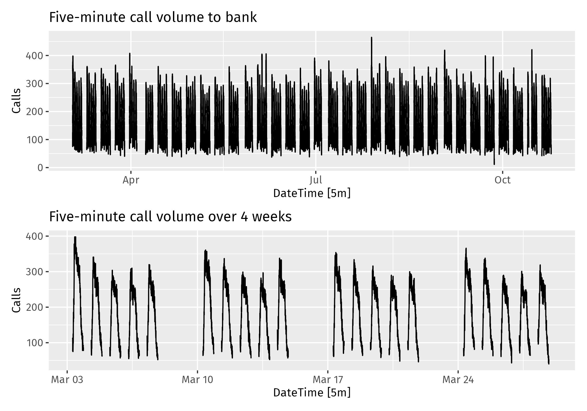

La serie tiene un patrón diario, porque las llamadas suben en la mañana y bajan en la tarde, y un patrón semanal, porque no hay llamadas durante el fin de semana.

## ¿Qué es Prophet?

- **Prophet** (Taylor y Letham, 2018) es un procedimiento creado por Facebook, hoy Meta, para pronosticar series de tiempo con un modelo aditivo. La tendencia puede ser no lineal y se combina con estacionalidad anual, semanal y diaria, además de los efectos de los días festivos.
- Funciona mejor con series que presentan **fuertes efectos estacionales** y que tienen varios periodos de datos históricos.
- Es robusto ante datos faltantes y cambios en la tendencia, y en general maneja bien los valores atípicos.

## Número de post en Facebook

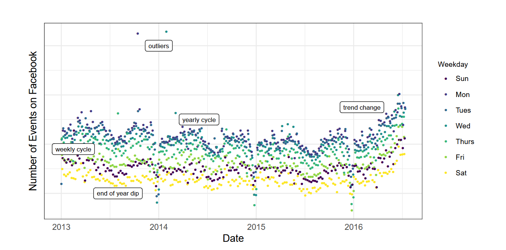

## El modelo Prophet

Prophet es un modelo de **descomposición aditiva** no lineal

$$y(t) = g(t) + s(t) + h(t) + \varepsilon_t$$

| Componente | Símbolo | Descripción |
|------------|---------|-------------|
| Tendencia | $g(t)$ | Tendencia de crecimiento lineal por tramos o logística |
| Estacionalidad | $s(t)$ | Patrones estacionales diario, semanal y anual |
| Festividades | $h(t)$ | Efectos de eventos festivos conocidos |
| Error | $\varepsilon_t$ | Término de error de ruido blanco |

## Componente de tendencia

Prophet implementa **dos modelos de tendencia**.

### 1. Crecimiento logístico (saturado)

$$g(t) = \frac{C(t)}{1 + \exp(-k(t - m))}$$

Donde $C(t)$ es la capacidad de saturación, que puede variar en el tiempo, $k$ es la tasa de crecimiento y $m$ es un parámetro de desplazamiento.

### 2. Tendencia lineal por tramos

$$g(t) = (k + \mathbf{a}(t)^\top \boldsymbol{\delta}) \cdot t + (m + \mathbf{a}(t)^\top \boldsymbol{\gamma})$$

Donde $k$ es la pendiente inicial y $m$ el intercepto. Los **puntos de cambio** $s_1, \dots, s_S$ son los momentos en que la pendiente puede cambiar. El vector $\mathbf{a}(t)$ indica cuáles puntos de cambio ya ocurrieron, con $a_j(t) = 1$ si $t \geq s_j$ y $0$ en otro caso. El vector $\boldsymbol{\delta}$ contiene el cambio de pendiente en cada punto, y $\gamma_j = -s_j \delta_j$ ajusta el intercepto para que la tendencia sea continua.

## Estimación de los puntos de cambio

- Prophet propone por defecto 25 puntos de cambio ubicados en el primer 80% de la serie (`n_changepoints` y `changepoint_range`).
- Los cambios de pendiente tienen una distribución a priori de Laplace, $\delta_j \sim \text{Laplace}(0, \tau)$, que lleva a cero los cambios que no son necesarios. Así, la mayoría de los puntos propuestos terminan sin efecto y solo quedan los cambios de tendencia que muestran los datos.
- El parámetro $\tau$ corresponde a `changepoint_prior_scale`. Un valor pequeño produce una tendencia más rígida y un valor grande una tendencia más flexible.
- Por defecto Prophet estima el modelo por máxima verosimilitud penalizada (máximo a posteriori) usando Stan. La estimación bayesiana completa con MCMC solo se realiza si se indica `mcmc_samples > 0`.

## Tendencia saturada logística Prophet

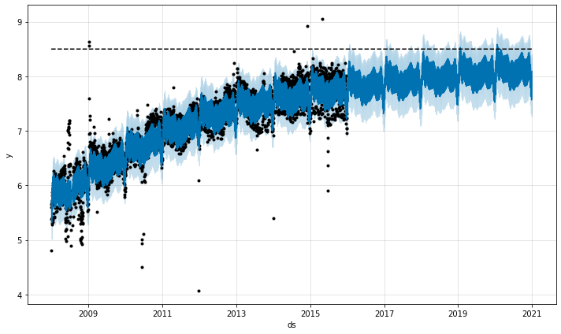

## Cambios de tendencia estimada por Prophet

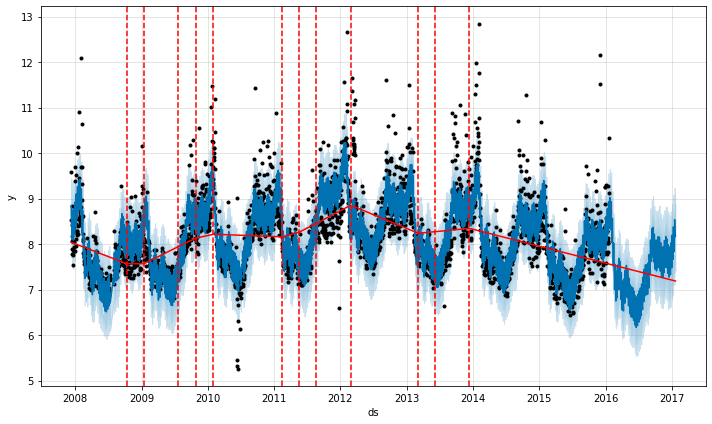

## Componente de estacionalidad

El componente estacional está formado por **términos de Fourier** de los periodos relevantes

$$s(t) = \sum_{n=1}^{N} \left[ a_n \cos\!\left(\frac{2\pi n t}{P}\right) + b_n \sin\!\left(\frac{2\pi n t}{P}\right) \right]$$

Donde $P$ es el periodo en días y $N$ controla la flexibilidad del patrón estacional.

| Estacionalidad | $P$ (días) | $N$ por defecto |
|----------------|-----------|------------|
| Anual | 365.25 | 10 |
| Semanal | 7 | 3 |
| Diaria | 1 | 4 |

Los coeficientes $\{a_n, b_n\}$ tienen una distribución a priori normal, cuya desviación estándar se controla con `seasonality_prior_scale`.

## Estacionalidad aditiva y multiplicativa

- Por defecto la estacionalidad es aditiva, por lo que la amplitud del patrón estacional es la misma sin importar el nivel de la serie.
- Cuando la amplitud de la estacionalidad crece con el nivel de la serie, como en el método de Holt-Winters multiplicativo que vimos en suavizamiento exponencial, se usa `seasonality_mode = "multiplicative"`. En ese caso el modelo es

$$y(t) = g(t) + g(t)\, s(t) + g(t)\, h(t) + \varepsilon_t$$

- Una alternativa equivalente es modelar el logaritmo de la serie con estacionalidad aditiva.

## Componente de festividades

Los efectos de los días festivos se agregan como variables indicadoras

$$h(t) = \mathbf{Z}(t) \cdot \boldsymbol{\kappa}$$

Donde $\mathbf{Z}(t)$ es una matriz que indica si $t$ cae en la ventana de una festividad y $\boldsymbol{\kappa}$ contiene los efectos estimados. Los efectos tienen una distribución a priori normal, cuya desviación estándar se controla con `holidays_prior_scale`.

Las festividades pueden tener **ventanas asimétricas**, es decir, el efecto puede empezar algunos días antes del evento y terminar algunos días después (`lower_window` y `upper_window`).

| Evento       | Comportamiento real                             |
|:-------------|:------------------------------------------------|
| Black Friday | Las ventas suben desde el jueves anterior |
| Cyber Monday | El efecto se extiende al martes siguiente       |
| Navidad      | La demanda aumenta varios días antes            |

## Festividades de Colombia

- Prophet incluye los calendarios de festivos de muchos países. Para Colombia se agregan con el código de país `CO`, que incluye los festivos que se trasladan al lunes por la Ley Emiliani.

```python
m = Prophet()
m.add_country_holidays(country_name="CO")
m.fit(df)
```

```r
m <- prophet()
m <- add_country_holidays(m, country_name = "CO")
m <- fit.prophet(m, df)
```

## Efecto de la estacionalidad y las festividades

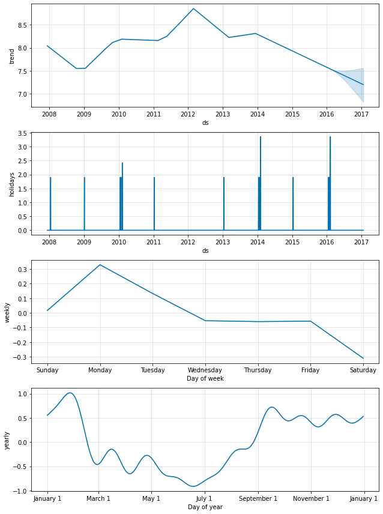

## Variables exógenas

- Prophet permite agregar regresoras al modelo con `add_regressor()`. Su efecto se suma a la tendencia, la estacionalidad y los festivos, de forma similar a un modelo ARIMAX.
- Por ejemplo, la demanda de electricidad depende de la temperatura y de si el día es laboral.
- Para pronosticar es necesario conocer o suponer los **valores futuros** de cada regresora, igual que en los modelos ARIMAX. Si la regresora no se conoce de antemano, como la temperatura, primero hay que pronosticarla o construir escenarios.

```python
m = Prophet()
m.add_regressor("Temperature")
m.add_regressor("Working_Day")
m.fit(df)          # df debe tener las columnas ds, y, Temperature y Working_Day
futuro = ...       # fechas futuras con valores de Temperature y Working_Day
pronostico = m.predict(futuro)
```

## Validación cruzada con ventana móvil

- Prophet incluye una función de validación cruzada para series de tiempo que mide el error de pronóstico con datos históricos.
- Se especifica el horizonte de pronóstico (`horizon`) y, opcionalmente, el tamaño del entrenamiento inicial (`initial`) y la distancia entre las fechas de corte (`period`).
- Por ejemplo, en una serie de 8 años con un horizonte de 365 días, un entrenamiento inicial de 730 días y un periodo de 180 días, el modelo se estima primero con dos años de datos y pronostica el año siguiente. Luego la fecha de corte avanza 180 días y el proceso se repite hasta que no queda un año completo para evaluar, lo que da 11 pronósticos en total.
- Para que la validación sea útil, la serie debe ser bastante más larga que `initial + horizon`. Con series cortas se obtienen muy pocos cortes y el error estimado es poco confiable.

`cross_validation(m, initial='730 days', period='180 days', horizon = '365 days')`

## Validación cruzada con ventana móvil

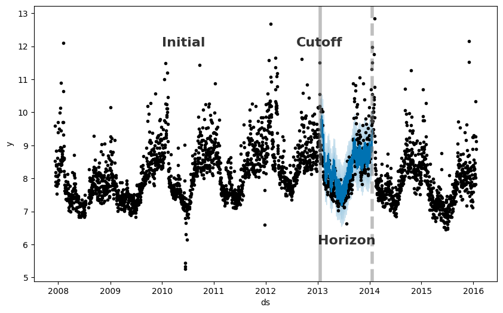

## Ajuste de hiperparámetros

- La validación cruzada permite ajustar los hiperparámetros del modelo, en especial las distribuciones a priori de los cambios de tendencia, la estacionalidad y los festivos.
- `changepoint_prior_scale` controla la flexibilidad de la tendencia. Su valor por defecto es 0.05 y se recomienda buscar en el rango [0.001, 0.5]. Con un valor pequeño el modelo pierde ajuste y con un valor grande tiende al sobreajuste.
- `seasonality_prior_scale` controla la flexibilidad de la estacionalidad. Su valor por defecto es 10 y se recomienda buscar en el rango [0.01, 10]. Un valor grande permite que la estacionalidad capture grandes fluctuaciones y un valor pequeño reduce su magnitud.
- `holidays_prior_scale` cumple el mismo papel para los efectos de los festivos.
- `seasonality_mode` permite elegir entre estacionalidad aditiva y multiplicativa.

## Un comentario acerca de Prophet

- A pesar de su sofisticación, Prophet no suele ganar mucha precisión frente a los modelos SARIMA, ETS y de regresión dinámica. Hyndman y Athanasopoulos lo comentan así.

> Prophet has the advantage of **being much faster** to estimate than the dynamic harmonic regression (DHR) models we have considered previously, and it is **completely automated**. However, it **rarely gives better forecast** accuracy than the alternative approaches, as these two examples have illustrated. [Forecasting: principles and practice, 3rd edition. Prophet model](https://otexts.com/fpp3/prophet.html)

- Por eso, antes de elegir Prophet o una LSTM, siempre se deben comparar contra modelos de referencia.

## Usar Prophet

### Python
```bash
pip install prophet pandas numpy matplotlib
```

```python
from prophet import Prophet
from prophet.diagnostics import cross_validation, performance_metrics
from prophet.plot import plot_cross_validation_metric
import pandas as pd
```

### R

El paquete `fable.prophet` permite estimar Prophet con la misma sintaxis de `fable` que usamos para ARIMA y ETS.

```r
install.packages(c("prophet", "fable.prophet"))

library(fable)
library(fable.prophet)

modelo <- datos |>
  model(
    prophet = prophet(y ~ growth("linear") + season("week") + season("year"))
  )
```

# LSTM — Long Short-Term Memory {background-color="#0d3b66"}

## Modelos de redes neuronales

- Una red neuronal es un conjunto de neuronas organizadas en capas. Los predictores o entradas forman la capa inferior y los pronósticos o salidas forman la capa superior. Entre ellas puede haber capas intermedias con neuronas ocultas.

::: {.columns}

::: {.column}

- Las redes más sencillas no tienen capas ocultas y equivalen a una regresión lineal.

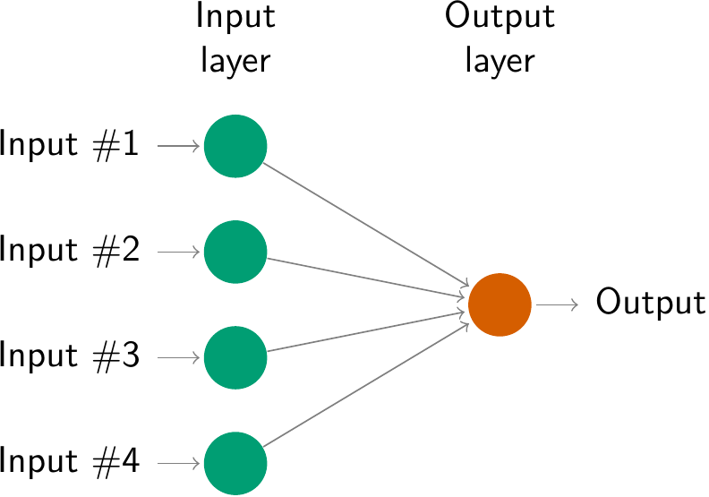

:::

::: {.column}

- Cuando hay capas ocultas se tiene una red de propagación hacia adelante multicapa (perceptrón multicapa), en la que cada capa recibe como entradas las salidas de la capa anterior.

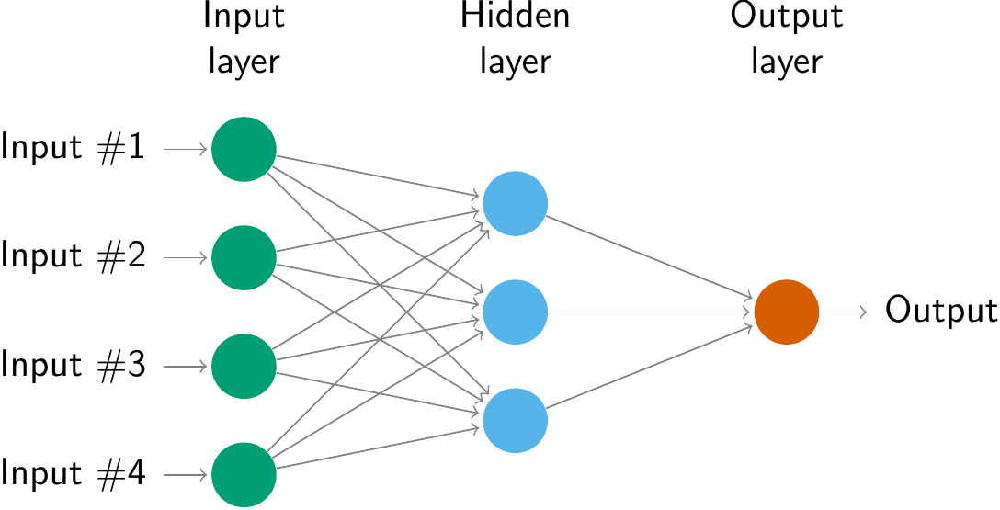

:::

:::

## Perceptrón con función de activación sigmoide

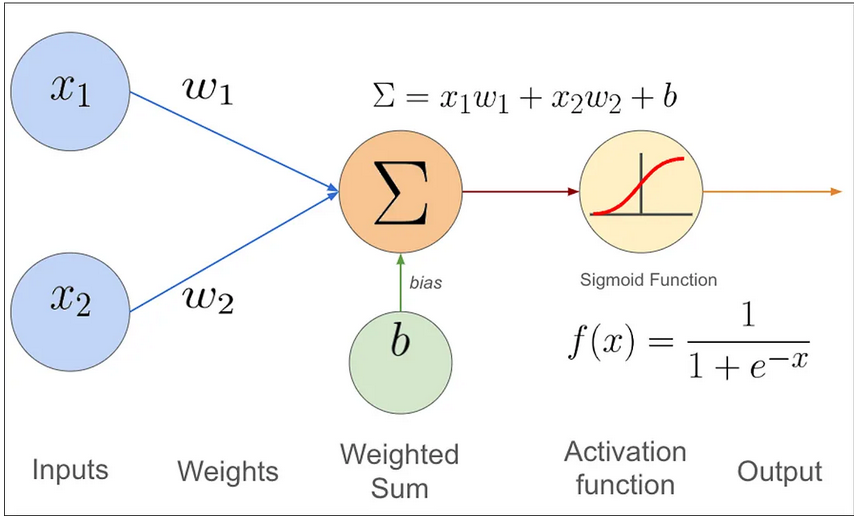

## Funciones de activación

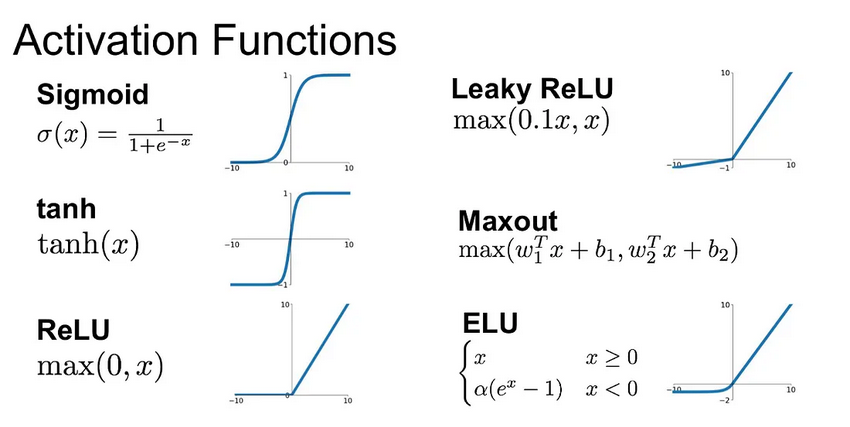

## Cómo elegir la función de activación en pronósticos

La elección de la función de activación depende del tipo de problema y de la capa de la red.

### Capa de salida

Pronosticar una serie de tiempo es un problema de regresión, porque se predice un valor continuo. Por eso la capa de salida usa una **activación lineal** (identidad), que permite que el pronóstico tome cualquier valor real. Las activaciones sigmoide y softmax en la salida se usan en problemas de clasificación.

### Capas ocultas

En las capas ocultas densas la opción más común es la función **ReLU**. La función tanh también es frecuente, en especial en redes recurrentes.

### Dentro de una LSTM

Las compuertas usan la función **sigmoide**, porque producen valores entre 0 y 1 que indican qué proporción de la información pasa. La memoria candidata y el estado oculto usan la función **tanh**.

## Redes Neuronales Recurrentes (RNN)

- Una **red neuronal recurrente (RNN)** procesa una secuencia elemento por elemento y mantiene un estado con la información de lo que ha visto hasta ese momento. Las RNN son redes neuronales con un ciclo interno que conecta cada paso de tiempo con el siguiente.

- Si pensamos en la serie de tiempo $y_t$ como una **secuencia donde cada valor depende de los anteriores**, las RNN están diseñadas precisamente para capturar esa dependencia temporal.

Las **RNN** procesan secuencias manteniendo un estado oculto $h_t$

$$h_t = \tanh(W_h \cdot h_{t-1} + W_x \cdot x_t + b)$$

$$\hat{y}_t = W_y \cdot h_t + b_y$$

## Esquema de una RNN

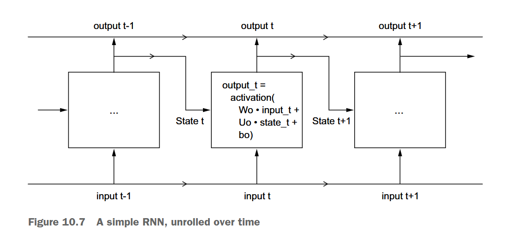

## Problema del gradiente que desaparece en RNN

- Los pesos de una RNN se estiman con **retropropagación a través del tiempo** (*backpropagation through time*, BPTT). La red se despliega en todos los pasos de la secuencia y el gradiente de la pérdida se propaga desde el último paso hasta el primero.

- Por la regla de la cadena, el gradiente con respecto a un estado lejano es un producto de muchas derivadas

$$\frac{\partial L}{\partial h_1} = \frac{\partial L}{\partial h_T} \prod_{t=2}^{T} \frac{\partial h_t}{\partial h_{t-1}}$$

- Si estas derivadas son menores que uno, el producto tiende a **cero exponencialmente** y el gradiente desaparece. Si son mayores que uno, el producto crece sin control y el gradiente **explota**. Este segundo problema se controla limitando la norma del gradiente (*gradient clipping*).

- Cuando el gradiente desaparece, la red no puede aprender **dependencias de largo plazo**, lo que afecta a las series con memoria larga o con estacionalidades de periodo largo.

- La LSTM resuelve este problema actualizando su memoria con una **suma** en lugar de una multiplicación repetida, como se ve en la ecuación de la celda de memoria.

## Gradiente RNN vs LSTM

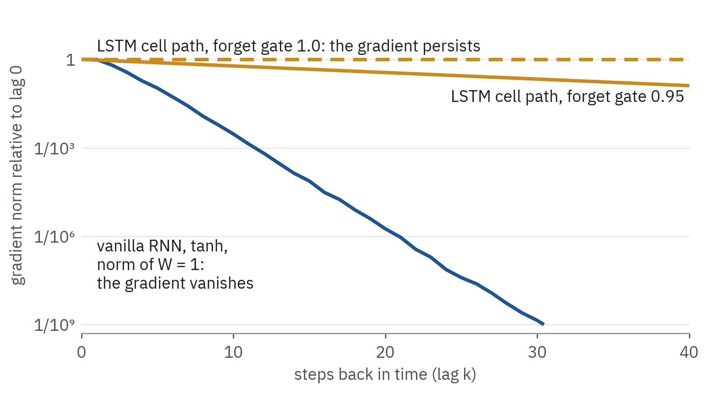

## Arquitectura LSTM (Long Short-Term Memory)

Las LSTM introducen una **celda de memoria** $C_t$ controlada por tres compuertas.

### Compuerta de olvido
Decide qué información de la memoria anterior $C_{t-1}$ ya no es útil.
$$f_t = \sigma(W_f \cdot [h_{t-1}, x_t] + b_f)$$

### Compuerta de entrada
Decide qué información nueva del paso actual se guarda en la memoria.
$$i_t = \sigma(W_i \cdot [h_{t-1}, x_t] + b_i)$$

### Compuerta de salida
Decide qué parte de la memoria $C_t$ es relevante para la predicción actual.
$$o_t = \sigma(W_o \cdot [h_{t-1}, x_t] + b_o)$$

Las compuertas usan la **función sigmoide** $\sigma(z) = \frac{1}{1+e^{-z}}$, que produce valores en $(0,1)$.

## Actualización de la memoria en la LSTM

La memoria candidata resume la información nueva del paso actual
$$\tilde{C}_t = \tanh(W_C \cdot [h_{t-1}, x_t] + b_C)$$

La celda de memoria combina la memoria anterior con la memoria candidata
$$C_t = f_t \odot C_{t-1} + i_t \odot \tilde{C}_t$$

El estado oculto, que se usa para el pronóstico, es una versión filtrada de la memoria
$$h_t = o_t \odot \tanh(C_t)$$

Donde $\odot$ es el producto de Hadamard (multiplicación elemento a elemento entre dos matrices o vectores del mismo tamaño).

- La memoria se actualiza sumando, no multiplicando. Cuando la compuerta de olvido $f_t$ está cerca de uno, la información de $C_{t-1}$ pasa casi sin cambios al siguiente paso, y el gradiente también, por lo que no desaparece.

## Flujo de información en LSTM

::: {.callout-note}

La idea central de la LSTM es guardar la información del pasado en la celda de memoria $C_t$, de forma que los **efectos de largo plazo se mantengan** a lo largo de la secuencia.

:::

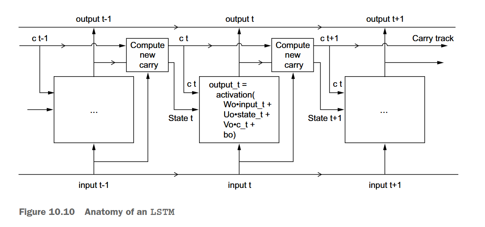

## Variantes de LSTM

| Variante | Diferencia clave |
|----------|-----------------|
| **LSTM estándar** | Arquitectura original (Hochreiter y Schmidhuber, 1997) |
| **Peephole LSTM** | Las compuertas observan directamente $C_{t-1}$ |
| **GRU** | Fusiona las compuertas de olvido y entrada y no tiene una celda $C_t$ separada |
| **LSTM bidireccional** | Procesa la secuencia en ambas direcciones |
| **LSTM apilada** | Varias capas LSTM una sobre otra |

## Buenas prácticas al entrenar una LSTM

- La partición de los datos debe respetar el orden del tiempo. El entrenamiento usa las primeras observaciones y la validación y la prueba usan las últimas, sin mezclar el orden.
- El escalamiento (por ejemplo, `MinMaxScaler`) se ajusta **solo con los datos de entrenamiento** y luego se aplica a validación y prueba. Si se ajusta con toda la serie, el modelo usa información del futuro y el error de prueba resulta optimista.
- Un pronóstico a un paso usa los valores reales recientes como entrada. Para pronosticar varios pasos hacia adelante hay que usar los propios pronósticos como entradas (pronóstico recursivo) o entrenar la red para que entregue los $h$ valores a la vez. Al comparar con Prophet o ARIMA, todos los modelos deben evaluarse con el mismo horizonte.
- La parada temprana (*early stopping*) con un conjunto de validación ayuda a evitar el sobreajuste.

## Uso de LSTM en Python

### Keras/TensorFlow

```bash
# Instalación
pip install tensorflow keras scikit-learn numpy pandas
```

```python
# Importaciones esenciales
import numpy as np
import pandas as pd
from tensorflow import keras
from tensorflow.keras import layers, callbacks, optimizers
from sklearn.preprocessing import MinMaxScaler
```

### NeuralForecast (Nixtla)

La librería `neuralforecast`, de la misma familia que `statsforecast` y `mlforecast`, incluye LSTM y otras redes para series de tiempo, con el escalamiento, las ventanas y la validación cruzada ya implementados.

```bash
pip install neuralforecast
```

```python
from neuralforecast import NeuralForecast
from neuralforecast.models import LSTM

# df con las columnas unique_id, ds, y
nf = NeuralForecast(models=[LSTM(h=30, input_size=60, max_steps=500)], freq="D")
nf.fit(df)
pronostico = nf.predict()
```

## Uso de LSTM en R

### torch

El paquete `torch` implementa redes neuronales directamente en R, sin necesidad de instalar Python.

```r
install.packages("torch")
library(torch)
install_torch()   # descarga las librerías de cálculo (solo la primera vez)

modelo_lstm <- nn_module(
  initialize = function(n_variables, n_ocultas = 100) {
    self$lstm    <- nn_lstm(input_size = n_variables, hidden_size = n_ocultas, batch_first = TRUE)
    self$dropout <- nn_dropout(p = 0.2)
    self$salida  <- nn_linear(n_ocultas, 1)   # salida lineal para regresión
  },
  forward = function(x) {
    salida_lstm <- self$lstm(x)[[1]]          # (muestras, pasos, neuronas)
    h_final <- salida_lstm[, dim(x)[2], ]     # estado oculto del último paso
    self$salida(self$dropout(h_final))
  }
)
```

### keras3

El paquete `keras3` usa TensorFlow, por lo que requiere un entorno de Python.

```r
install.packages(c("keras3", "tensorflow"))

library(keras3)
install_keras(backend = "tensorflow")  # Instala TensorFlow en el entorno Python (una sola vez)
```

# Comparación de modelos {background-color="#4a1942"}

## Comparación LSTM y Prophet

| Dimensión | LSTM | Prophet |
|-----------|------|---------|
| **Paradigma** | Aprendizaje profundo | Modelo estadístico bayesiano |
| **Interpretabilidad** | Baja, es difícil explicar sus pronósticos | Alta, cada componente se puede graficar |
| **Datos requeridos** | Miles de observaciones | Al menos dos ciclos completos de la estacionalidad más larga |
| **Estacionalidad** | Aprendida implícitamente | Modelada explícitamente |
| **Festividades** | Requiere crear variables manualmente | Soporte nativo |
| **Variables exógenas** | Variables adicionales en cada ventana | `add_regressor()` |
| **Entrenamiento** | Puede ser lento; con series pequeñas basta la CPU | Segundos a minutos |
| **Hiperparámetros** | Muchos y sensibles | Pocos e intuitivos |

## Comparación con modelos de referencia

- Un modelo complejo solo se justifica si pronostica mejor que modelos más simples. Por eso Prophet y la LSTM deben compararse con el ingenuo estacional, ETS, ARIMA y la regresión armónica dinámica.
- Todos los modelos se estiman con el mismo conjunto de entrenamiento y se evalúan con el mismo conjunto de prueba y el mismo horizonte, usando métricas como RMSE, MAE y MAPE.

[Example: Quarterly cement production](https://otexts.com/fpp3/advanced.html#example-quarterly-cement-production)

## Aplicaciones Long Short-Term Memory (LSTM)

::: {.columns}

::: {.column}


[Colombian inflation forecast using Long Short-Term Memory approach](https://www.banrep.gov.co/en/colombian-inflation-forecast-using-long-short-term-memory-approach)

:::

::: {.column}

- El estudio aplica redes **LSTM** para pronosticar la inflación en Colombia a **12 meses** y compara dos enfoques, uno univariado que solo usa la inflación y uno multivariado que incluye variables exógenas relevantes.

- El entrenamiento usa una **muestra móvil** y los hiperparámetros se eligen minimizando el error de pronóstico.

- El enfoque **multivariado supera** al univariado y a modelos ARIMA optimizados, con y sin variables explicativas.

- La ventaja del modelo multivariado es **mayor en los horizontes largos**, entre el séptimo y el duodécimo mes.
:::

:::

## Ejemplos resueltos

Los dos ejemplos pronostican la demanda diaria de electricidad en Victoria, Australia, durante los últimos 90 días de 2014. Usan los mismos datos y el mismo periodo de prueba, por lo que sus resultados se pueden comparar entre sí y con el modelo ingenuo estacional.

- [Prophet en Python](https://github.com/fersalme/regresion-lineal-series-tiempo/blob/main/09-modelos-LSTM-prophet/03-ejercicios-Prophet-Python.ipynb). Incluye festivos, temperatura y día laboral como regresoras, validación cruzada y ajuste de hiperparámetros.
- [LSTM en Python](https://github.com/fersalme/regresion-lineal-series-tiempo/blob/main/09-modelos-LSTM-prophet/03-ejercicios-LSTM-Python.ipynb). Incluye escalamiento ajustado solo con el entrenamiento, parada temprana y pronóstico a un paso y recursivo.

## Referencias Bibliográficas

- Hochreiter, S. y Schmidhuber, J. (1997). *Long Short-Term Memory*. Neural Computation, 9(8), 1735–1780.
- Graves, A. (2013). *Generating Sequences With Recurrent Neural Networks*. arXiv:1308.0850.
- Taylor, S.J. y Letham, B. (2018). *Forecasting at Scale*. The American Statistician, 72(1), 37–45.
- Hyndman, R.J. y Athanasopoulos, G. (2021). *Forecasting: principles and practice*, 3rd edition. OTexts, Melbourne, Australia. [OTexts.com/fpp3](https://otexts.com/fpp3/)
- Meta Research. *Prophet Documentation*. [facebook.github.io/prophet](https://facebook.github.io/prophet)
- O'Hara-Wild, M. *fable.prophet: Prophet Modelling Interface for fable*. [pkg.mitchelloharawild.com/fable.prophet](https://pkg.mitchelloharawild.com/fable.prophet/)
- Nixtla. *NeuralForecast Documentation*. [nixtlaverse.nixtla.io/neuralforecast](https://nixtlaverse.nixtla.io/neuralforecast/)
- Falbel, D. y Luraschi, J. *torch for R*. [torch.mlverse.org](https://torch.mlverse.org)
- Chollet, F. et al. *Keras Documentation*. [keras.io](https://keras.io)
- Abadi, M. et al. *TensorFlow*. [tensorflow.org](https://www.tensorflow.org)
- Allaire, J. y Chollet, F. *R Interface to Keras*. [keras3.posit.co](https://keras3.posit.co)
